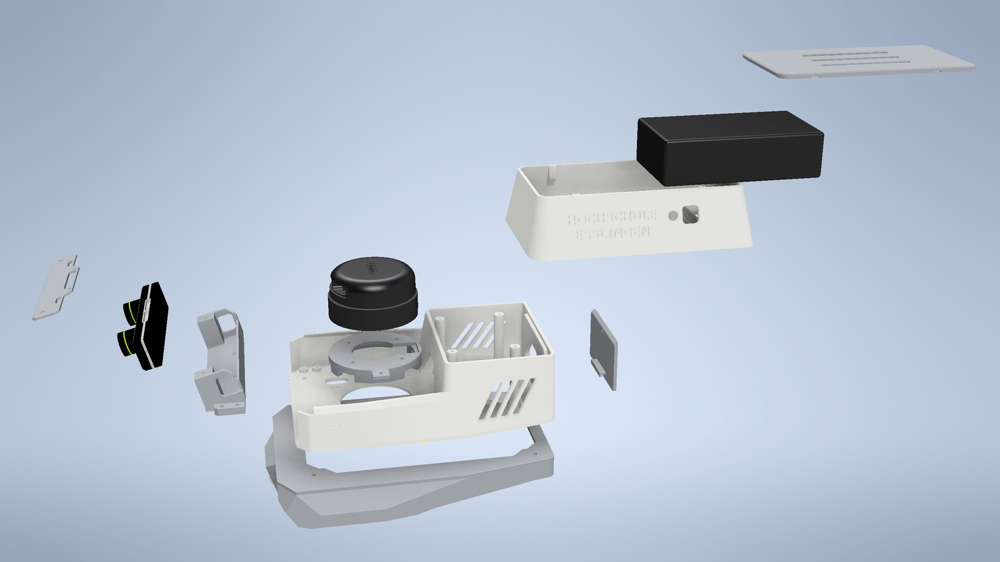
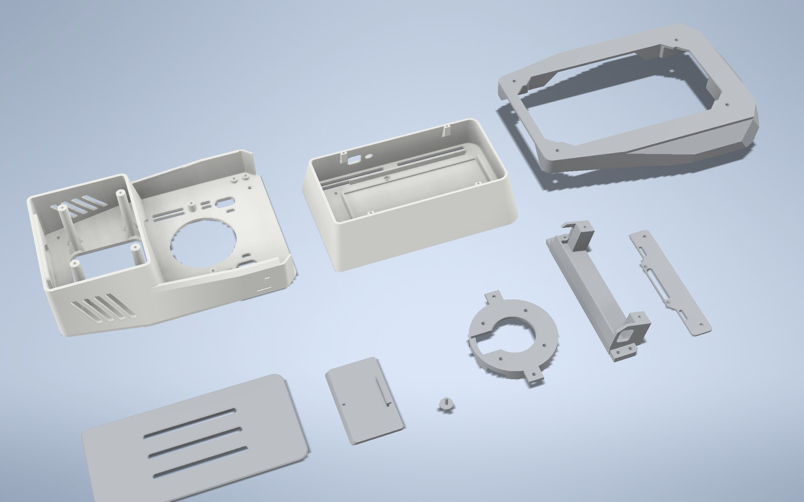

# Printed body V4.1

CAD of the printed body of the robot: nine PLA parts, printed without supports.
The front bay carries the RPLIDAR A2M8 on a pedestal and the ZED Mini in a
cradle pitched 15° nose down; the cabin holds the powerbank on two rails, with
its button and display reached from outside through a push pin and a window;
the wheels plate carries the lane camera at 0.30 rad nose down, the pose of
`camera_joint_lane` in the URDFs.

V4.1 is the current revision. It raises the powerbank cabin by 4.5 mm after the
first assembly test, adds the rails and the counterbores for the socket-head
screws under the powerbank, and shortens the button pin. The other parts are
those of V4.

 Exploded view of the body and its sensors: wheels plate with the lane camera, bot_V3 with the rear cover, RPLIDAR A2M8 on its pedestal, ZED Mini in its cradle with the cap, cabin with the push pin, powerbank and lid.

## Files

Each part is provided twice:

- **STL** for printing: oriented, standing on z = 0 and centred, in
  millimetres. High-resolution export of Autodesk Inventor 2026, closed meshes
  with the volume of the CAD within ±0.05 %. The slicer needs no rotation.
- **STEP** (AP214) for editing in any CAD system, in the frame of the part.

The file names are the part names of the CAD. The suffix `_V3` is historical:
V4 is the V3.4 body with the new rear port and its cover, `cam_plate_V4` and a
print and ventilation review.

| Part | Function | Print orientation | Size (mm) | PLA |
| --- | --- | --- | --- | --- |
| `bot_V3` | Floor, front bay and tapered cable chamber, with side fairings, ventilation slots and the rear port (68 × 32 mm) | Floor on the bed | 220.0 × 160.0 × 60.0 | 95 g |
| `top_V3` | Powerbank cabin: closes the cable chamber and holds the powerbank on two rails; display window and push-pin hole in the left flank | Cabin floor on the bed | 192.0 × 122.0 × 49.5 | 75 g |
| `battery_lid_V3` | Magnetic lid of the cabin, with ventilation slots | Upside down: top face on the bed | 176.0 × 92.0 × 5.0 | 25 g |
| `lidar_mount_V3` | 12 mm pedestal of the RPLIDAR A2M8, with ventilation notches above the Jetson fan | Upside down: deck on the bed | 80.0 × 104.0 × 12.0 | 11 g |
| `zed_cradle_V3` | Cradle of the ZED Mini, 15° nose down | Base on the bed | 38.4 × 150.0 × 35.1 | 25 g |
| `zed_cap_V3` | Clamp cap of the ZED Mini | Bottom face on the bed | 27.0 × 131.1 × 2.0 | 3 g |
| `rear_cover_V3` | Flush magnetic cover of the rear port, with a hook at the bottom | Outer face on the bed | 47.4 × 79.4 × 8.5 | 6 g |
| `pb_pin_V3` | Push pin of the powerbank button, through the left wall of the cabin | Standing: pressed face on the bed | 12.0 × 12.0 × 13.8 | < 1 g |
| `cam_plate_V4` | Wheels plate with skirts and the lane-camera pod (IMX219); derived from Full Plate_wheels | Upside down: deck on the bed | 245.6 × 187.0 × 43.5 | 62 g |

PLA masses are CAD volumes at 0.539 g/cm³, the density that reproduces the
weighed shells of the previous body
([parameters.md §2.1](../../Mathematical%20Model/parameters.md#21-total-robot-mass));
together about 0.30 kg. The printed V4.1 parts have not been weighed.

 The nine printed parts. Back row: bot_V3, top_V3, cam_plate_V4. Front row: lid, rear cover, push pin, LiDAR pedestal, ZED cradle and cap.

## Printing

| Setting | Value |
| --- | --- |
| Material, nozzle | PLA, 0.4 mm |
| Layer height | 0.20 mm |
| Supports | Off: overhangs are at most 45° and bridges at most 26 mm |
| Perimeters | 3 (1.2 mm), so the pilot holes of the self-tapping screws lie in solid plastic |
| Infill | 20–25 %, gyroid or grid, 4 top and 4 bottom layers |
| Part cooling | 100 % from layer 3; bridges at 100 % and reduced speed |
| Elephant-foot compensation | 0.1–0.2 mm: holes and slots open onto the bed face |
| Bed | At least 230 × 170 mm for `bot_V3` and 250 × 190 mm for `cam_plate_V4` |

The push pin is small: print it together with another part, or with a minimum
layer time, so that each layer cools.

## Fasteners

All screws are M3 except those of the ZED Mini and the lane camera (M2).

| Joint | Fastener | Qty |
| --- | --- | --- |
| `bot_V3` and `cam_plate_V4` → chassis (existing Ø4 holes) | M3 (M3×15 in the original assembly) | 4 |
| Lane camera (Arducam IMX219) → posts of `cam_plate_V4` | M2×6 self-tapping | 4 |
| RPLIDAR A2M8 → pedestal | M3×6 from below, at most 4 mm into the LiDAR (M3×7 maximum) | 4 |
| Pedestal → `bot_V3` | M3×12 self-tapping | 2 |
| ZED Mini → cradle, from below | M2×6 | 2 |
| ZED cap → ZED Mini, from above | M2×4 countersunk | 2 |
| ZED cap → cradle posts | M3×10 self-tapping | 2 |
| Cradle → `bot_V3`, through the tabs | M3×8 self-tapping | 4 |
| Cabin → pillars of `bot_V3`, from inside the cabin | M3×12 socket head (DIN 912); the two front heads sit in the counterbores of the rails | 4 |
| Powerbank lid | Magnets 2 × 2 × 2 mm, 4 pairs | 8 |
| Rear-port cover | Magnets 2 × 2 × 2 mm, 1 pair | 2 |

## Assembly

1. **Lane camera**, before the plate goes onto the chassis: pass the flex
   through the slot in the front wall of `cam_plate_V4`, connect it to the
   camera and screw the camera onto the four posts (4 × M2×6).
2. **Plate and floor**: `cam_plate_V4` and `bot_V3` onto the chassis with the
   four existing screws. The two front screws lie under the ZED cradle and are
   fitted first.
3. **LiDAR**: the A2M8 onto its pedestal on the bench (4 × M3×6 from below),
   then the pedestal onto `bot_V3` (2 × M3×12).
4. **ZED Mini**, on the bench: camera into the cradle (2 × M2×6 from below),
   cap onto the camera (2 × M2×4) and the cradle posts (2 × M3×10). The cradle
   sits on the four bosses of `bot_V3` (4 × M3×8).
5. **Cables** through the front entry and the cable chamber to the Jetson. The
   ZED cable runs in the duct of the right fairing (seen from the front).
6. **Cabin** onto the pillars of `bot_V3`: 4 × M3×12 socket head, from inside
   the cabin.
7. **Powerbank**: insert the push pin from inside through the hole in the left
   wall, then the powerbank, ports to the rear and display to the left, on the
   two rails. Pressing the pin switches it on; select 19 V on the DC output for
   the Jetson and check it on the display, through the window.
8. **Magnets** of the lid and of the rear cover, with cyanoacrylate: glue one
   magnet of each pair into the body, place its mate on it as it attracts, and
   lower the part with glue in its pockets, which aligns them with the correct
   polarity.

## ROS package

The URDFs draw this body assembled, with one mesh:
[`src/cobraflex/meshes/cobraflex_body.stl`](../../../src/cobraflex/meshes/README.md).
The inertia of `body_link` is integrated on these parts
([parameters.md §2.1](../../Mathematical%20Model/parameters.md#21-total-robot-mass)).
A change to the CAD requires both files to be regenerated.
