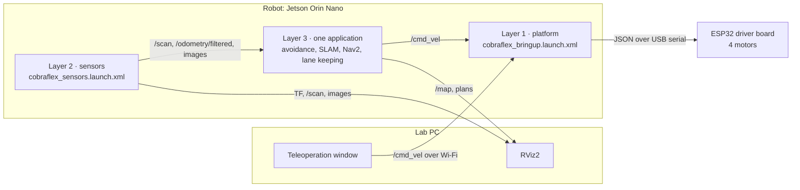

# Robot operation

Operation of the physical Cobra Flex from switching on to switching off:
connection, bring-up, the applications that run on the robot, shutdown and
troubleshooting. The guide addresses an operator who knows ROS 2 but not this
repository. Machine setup is described in [1_INSTALLATION.md](1_INSTALLATION.md),
the simulation in [2_USAGE.md](2_USAGE.md) and the theory in
[docs/concepts](concepts/README.md).

---

## Contents

- [1. System overview](#1-system-overview)
- [2. Requirements](#2-requirements)
- [3. Conventions and setup card](#3-conventions-and-setup-card)
- [4. Preparation](#4-preparation)
- [5. Switching on and connecting](#5-switching-on-and-connecting)
- [6. Bring-up](#6-bring-up)
- [7. Applications](#7-applications)
- [8. Simulation](#8-simulation)
- [9. Switching off](#9-switching-off)
- [10. Safety rules](#10-safety-rules)
- [11. Troubleshooting](#11-troubleshooting)
- [12. Command reference](#12-command-reference)

---

## 1. System overview

The robot and the lab PC form one ROS 2 graph over the lab Wi-Fi. Drivers,
sensors and controllers run on the Jetson Orin Nano of the robot; the PC runs
RViz, the teleoperation window and inspection commands.



| Layer | Launch file on the robot | Nodes | Main outputs |
| --- | --- | --- | --- |
| 1 · Platform | `cobraflex_bringup.launch.xml` | `robot_state_publisher`, `joint_state_publisher`, `cobraflex_driver` | `/robot_description`, robot TF, `/cobraflex/battery`; consumes `/cmd_vel` |
| 2 · Sensors | `cobraflex_sensors.launch.xml` | `sllidar_node`, ZED Mini wrapper (`/zed/zed_node`), `csi_camera_node`, `ekf_filter_node` | `/scan`, `/zed/zed_node/odom`, `/camera/image_raw_lane`, `/odometry/filtered`, TF `odom → base_footprint` |
| 3 · Application | One at a time, §7 | Controller | `/cmd_vel` |

Layers 1 and 2 keep running while applications are exchanged. At most one
application publishes `/cmd_vel` at any time; nothing in the stack arbitrates
between two publishers.

| Application | Layer 1 | Layer 2 | Further requirement | Section |
| --- | --- | --- | --- | --- |
| Teleoperation | Required | Optional | — | [7.1](#71-teleoperation) |
| LiDAR obstacle avoidance | Required | Required (LiDAR) | Enclosed area with walls or boxes | [7.2](#72-lidar-obstacle-avoidance) |
| SLAM mapping | Required | Required (LiDAR; ZED odometry through the EKF) | — | [7.3](#73-slam-mapping) |
| Navigation (Nav2) | Required, with `min_angular_in_place:=0.2` | Required (LiDAR, ZED, EKF) | Saved map of the area | [7.4](#74-navigation-with-nav2) |
| Lane keeping | Required | Optional, without the lane camera | Track with lane markings | [7.5](#75-lane-keeping) |

The ZED Mini is the only odometry source of the robot: the EKF fuses its visual
odometry and publishes `odom → base_footprint`. SLAM and Nav2 therefore depend
on it; teleoperation, avoidance and lane keeping do not.

---

## 2. Requirements

| Item | State |
| --- | --- |
| Robot | Ubuntu 22.04 with ROS 2 Humble on the Jetson; this repository built in `~/ros2_ws` together with `sllidar_ros2` and `zed_wrapper` (ZED SDK installed); login in the `dialout` group. Reinstallation: [1_INSTALLATION.md](1_INSTALLATION.md#hardware-dependencies) |
| Batteries | Motor battery (3S Li-ion pack in the chassis) and powerbank (Jetson) charged |
| Lab PC | Ubuntu 22.04, ROS 2 Humble, this repository built in `~/ros2_ws` ([1_INSTALLATION.md](1_INSTALLATION.md)), on the lab network |
| Setup card | One per robot, with the access data ([§3](#3-conventions-and-setup-card)) |
| Area | Floor free of people and cables; a box or stand that lifts the wheels off the ground for the first motion test |

---

## 3. Conventions and setup card

| Placeholder | Meaning |
| --- | --- |
| `<car>` | Host name or IP address of the robot |
| `<user>` | Login on the robot |
| `<id>` | `ROS_DOMAIN_ID` shared by the robot and its PC |

Terminal labels: **[PC]** is a terminal on the lab PC; **[C1]** to **[C4]** are
SSH terminals on the robot (C1 layer 1, C2 layer 2, C3 application, C4 checks).
In every terminal the workspace is sourced
(`source ~/ros2_ws/install/setup.bash`, normally in `~/.bashrc`).

**Setup card.** Access data are kept on a card with each robot or in the lab,
not in this repository, which is public. Fields of the card:

| Field | Content |
| --- | --- |
| Robot | Name or number |
| Address | Host name or IP address (`<car>`) |
| Login | `<user>` and password |
| Domain | `ROS_DOMAIN_ID` (`<id>`), 1 to 101, never 0, different for every robot |
| Chassis port | Serial device of the driver board, default `/dev/ttyACM1` |
| Lab PC | PC paired with the robot |
| Network | Lab Wi-Fi name |

---

## 4. Preparation

### 4.1 Environment of each terminal

[PC] and [C4]:

```bash
printenv | grep -E '^ROS_(DISTRO|DOMAIN_ID|LOCALHOST_ONLY)='
```

| Variable | Required value | Consequence of a wrong value |
| --- | --- | --- |
| `ROS_DISTRO` | `humble` | Workspace not sourced: `ros2` or the packages are missing |
| `ROS_DOMAIN_ID` | `<id>`, identical on PC and robot | PC and robot do not see each other, or the PC sees another robot |
| `ROS_LOCALHOST_ONLY` | Unset or `0` | The PC terminal sees nothing of the robot |

Permanent setting of the domain, on both machines:

```bash
echo "export ROS_DOMAIN_ID=<id>" >> ~/.bashrc   # takes effect in new terminals
ros2 daemon stop                                 # the CLI daemon keeps the old value otherwise
```

Simulation terminals follow a different rule ([§8](#8-simulation)).

### 4.2 Software update

After a change to the repository, on both machines:

```bash
cd ~/ros2_ws && git pull && colcon build --symlink-install
```

---

## 5. Switching on and connecting

1. **Stand.** For the first motion test of the day, place the robot on a box
   so that the wheels turn freely.
2. **Motor battery.** Switch on the chassis. The driver board must be powered
   before layer 1 starts.
3. **Jetson.** Switch on the powerbank. The Jetson boots and joins the lab
   Wi-Fi.
4. **Network.** [PC] `ping <car>` until the robot answers.
5. **Terminals.** [PC] open four terminals and run `ssh <user>@<car>` in each:
   C1 to C4.

Closing an SSH terminal also ends the processes started in it.

---

## 6. Bring-up

### 6.1 Layer 1: platform

[C1]

```bash
ls /dev/ttyACM* /dev/ttyUSB*
ros2 launch cobraflex cobraflex_bringup.launch.xml use_rviz:=false
```

- `use_rviz:=false`: the robot has no display; RViz runs on the PC
  ([§6.3](#63-rviz-on-the-pc)).
- The driver board appears as `/dev/ttyACM*`, the LiDAR as `/dev/ttyUSB0`.
  The launch file uses `/dev/ttyACM1`; another device is passed as
  `serial_port:=/dev/ttyACM0`. Comparing `ls /dev/ttyACM*` with the USB cable
  of the driver board plugged in and unplugged identifies the device.

| Check | Expected result |
| --- | --- |
| Output of C1 | `Connected to /dev/ttyACM1` and `Requested feedback stream (T=131)` |
| Chassis | Both indicator lights on; they switch off when layer 1 stops |
| [C4] `ros2 topic echo /cobraflex/battery --once` | Voltage of the motor battery in V: 12.6 V when full; recharge at about 10.5 V (3.5 V per cell) |

### 6.2 Layer 2: sensors

[C2]

```bash
ros2 launch cobraflex cobraflex_sensors.launch.xml
```

The LiDAR starts spinning. The ZED Mini needs several seconds to open; after an
update of the ZED SDK, the first start can take several minutes while the SDK
optimises its depth model.

[C4]

```bash
ros2 node list
ros2 topic hz /scan                     # LiDAR, about 10 Hz
ros2 topic hz /zed/zed_node/odom        # ZED visual odometry, input of the EKF
ros2 topic hz /odometry/filtered        # EKF output, about 30 Hz
ros2 topic hz /camera/image_raw_lane    # lane camera, about 20 Hz
ros2 run tf2_ros tf2_echo odom base_footprint
```

Image rates are measured on the robot: on the PC, `ros2 topic hz` on an image
topic transfers the raw images over Wi-Fi.

Nodes after layers 1 and 2:

```text
/cobraflex_driver          layer 1
/joint_state_publisher     layer 1
/robot_state_publisher     layer 1
/csi_camera_node           layer 2
/ekf_filter_node           layer 2
/sllidar_node              layer 2
/zed/zed_node              layer 2, with the container of the ZED wrapper
```

### 6.3 RViz on the PC

[PC]

```bash
rviz2 -d $(ros2 pkg prefix cobraflex)/share/cobraflex/rviz/bot_S2R.rviz
```

The layout shows the robot model, the LiDAR scan, the left and right ZED
images (compressed) and the lane camera, in the fixed frame `base_footprint`.
The lane camera arrives uncompressed (about 110 Mbit/s); when RViz lags, its
display is disabled.

### 6.4 First motion test

Layer 1 running, wheels off the ground or 1 m of free space around the robot.

[PC]

```bash
ros2 launch cobraflex_teleop_gui teleop_gui.launch.py max_linear:=0.2 max_angular:=1.0
```

In the *Buttons* mode a held button turns the wheels and releasing it stops
them. Closing the window stops the robot. If nothing moves:
[§11](#11-troubleshooting).

---

## 7. Applications

Applications run in [C3], except teleoperation on the PC. Each one is stopped
with Ctrl-C, or its window closed, before the next one starts.

### 7.1 Teleoperation

[PC]

```bash
ros2 launch cobraflex_teleop_gui teleop_gui.launch.py
```

| Mode | Behaviour |
| --- | --- |
| Buttons | Moves while a button is held, stops on release |
| Virtual joystick | Follows the handle, stops on release |
| Sliders | Linear and angular velocity held until changed or until STOP |

- Limits: 0.35 m/s and 2.0 rad/s by default; `max_linear:=` and
  `max_angular:=` lower them.
- The window publishes `/cmd_vel` continuously, zero included, and is closed
  before any other application starts.
- If the window stops responding, its watchdog commands zero after 0.5 s.

Keyboard alternative, without a window:

```bash
ros2 run teleop_twist_keyboard teleop_twist_keyboard
```

It starts at 0.5 m/s; `z` lowers both speeds by 10 % per key press and `k`
stops. The robot moves while a key is held and stops 0.5 s after the last key
press (driver deadman, [§10](#10-safety-rules)).

### 7.2 LiDAR obstacle avoidance

Reactive driving without a map: forward when the way is free, centring between
side obstacles, turning away from obstacles ahead.

[C3]

```bash
ros2 run cobraflex lidar_avoidance_node --ros-args -p forward_speed:=0.2 -p turn_speed:=1.5
```

| Parameter | Default | Effect |
| --- | --- | --- |
| `forward_speed` | 0.45 m/s | Cruise speed; 0.2 m/s for first runs |
| `turn_speed` | 3.0 rad/s | Yaw rate of an avoidance turn; 1.5 rad/s for first runs |
| `safe_distance` | 0.55 m | An obstacle closer than this in the front sector starts a turn towards the freer side |
| `hard_stop_distance` | 0.40 m | Below this distance the turn is made on the spot |
| `front_angle_deg` | 20° | Half-angle of the front sector |
| `lateral_safe_distance` | 0.30 m | A side obstacle closer than this slows the robot to 0.15 m/s and turns it away |
| `scan_timeout` | 0.5 s | The robot stops when `/scan` stops |

The node reads its parameters once at start-up; changes require a restart.

`cobraflex_automatic.launch.xml` starts layer 2 and this node with the default
speeds. It replaces the layer 2 command of §6.2 and is never started in
addition to it: a second layer 2 finds the sensors busy and adds a second EKF
publishing `odom → base_footprint`.

Stop: Ctrl-C; the node publishes a zero command on exit.

### 7.3 SLAM mapping

Layers 1 and 2 running.

[C3]

```bash
ros2 launch cobraflex cobraflex_mapping.launch.py rviz:=false
```

[PC], two terminals:

```bash
rviz2 -d $(ros2 pkg prefix cobraflex)/share/cobraflex/rviz/mapping_hw.rviz
ros2 launch cobraflex_teleop_gui teleop_gui.launch.py max_linear:=0.2
```

The robot is driven slowly through the area; the occupancy grid grows in RViz
(fixed frame `map`). The hardware profile `slam_toolbox_mapping_hw.yaml` maps at
1 cm per cell with loop closure disabled, so drift accumulated on a long loop
is not corrected.

The map is saved on the robot, where Nav2 runs. [C4]:

```bash
mkdir -p ~/maps
ros2 run nav2_map_server map_saver_cli -f ~/maps/lab_map
```

The command writes `~/maps/lab_map.pgm` and `~/maps/lab_map.yaml`. Afterwards
mapping is stopped (Ctrl-C in C3) and the teleoperation window closed.

A map saved as `~/ros2_ws/src/cobraflex/maps/cobraflex_map` becomes the
default of the navigation launch file after a rebuild of `cobraflex`
([maps/README.md](../src/cobraflex/maps/README.md)).

### 7.4 Navigation with Nav2

Requirements: a saved map ([§7.3](#73-slam-mapping)), layer 2, and layer 1
started with `min_angular_in_place:=0.2`. The firmware does not compensate
static friction: a pure rotation below about 0.2 rad/s does not move the
robot, and the final rotation of Nav2 at the goal stalls without an error
message. The argument raises small pure rotations to this value.

[C1], layer 1 restarted with the argument:

```bash
ros2 launch cobraflex cobraflex_bringup.launch.xml use_rviz:=false min_angular_in_place:=0.2
```

[C3]

```bash
ros2 launch cobraflex navigation.launch.py use_sim_time:=false rviz:=false map:=$HOME/maps/lab_map.yaml
```

- `use_sim_time:=false` is required on the robot: the launch file defaults to
  simulation time, which stands still without the `/clock` of Gazebo.
- `$HOME` instead of `~`: the shell does not expand `~` after `map:=`.

[PC]

```bash
rviz2 -d $(ros2 pkg prefix cobraflex)/share/cobraflex/rviz/navigation.rviz
```

1. **2D Pose Estimate:** click the real position of the robot on the map and
   drag in the direction of its heading. With a correct pose the LiDAR scan
   lies on the walls of the map.
2. **2D Goal Pose:** click the goal and drag its heading. The robot plans a
   path and drives at up to 0.35 m/s.

Teleoperation and Nav2 do not run at the same time. Stop: Ctrl-C in C3; the
driver stops the robot 0.5 s after the last command. Planner, controller and
footprint parameters: [`nav2_params.yaml`](../src/cobraflex/config/nav2_params.yaml).

### 7.5 Lane keeping

Classical camera controller (histogram tracker on the CSI camera) that follows
the right lane of a marked track at 0.12 m/s. `lane_keeper_node` opens the CSI
camera itself, and the camera admits a single reader: layer 2, if it runs, is
restarted without the lane camera.

[C2]

```bash
ros2 launch cobraflex cobraflex_sensors.launch.xml use_lane_camera:=false
```

[C3], robot placed in the right lane:

```bash
ros2 launch cobraflex cobraflex_lane_keeper.launch.py use_rviz:=false
```

[PC], monitoring:

```bash
ros2 topic echo /lane/status
ros2 topic echo /lane/confidence
```

| Topic | Content |
| --- | --- |
| `/lane/image_overlay` | Camera image with the detected lane; RViz *Image* display |
| `/lane/image_raw`, `/lane/image_mask`, `/lane/image_histogram` | Input image, binary mask, histogram |
| `/lane/error_norm`, `/lane/confidence`, `/lane/status` | Normalised lateral error, detection confidence, state |

The images reach the PC uncompressed; over Wi-Fi only one image display is
active at a time. The layout `rviz/lane_keeper.rviz` belongs to the Gazebo
controller: on the robot its `/lane/mask` and `/camera/image_raw_lane` displays
stay empty, and the topics above are selected instead.

Detection and control parameters (`lane_side`, `linear_speed`,
`angular_gain`, `threshold_val`, `roi_start_pct`, trapezoid of the bird's-eye
view) are set in `cobraflex_lane_keeper.launch.py`. With `stop_on_lost` the
robot stops when the lane is lost. Stop: Ctrl-C. The other applications use
layer 2 with the lane camera again.

### 7.6 Lab session programs

The programs of the lab sessions run on the lab PC and drive the robot over
Wi-Fi, with layers 1 and 2 running on the robot and `use_sim_time:=false`. Build
and start commands: [lab/README.md](../lab/README.md).

### 7.7 Components not operable from this repository alone

| Component | Missing dependency |
| --- | --- |
| Safety-cage demonstration `ros2 launch safety_cage lane_following.launch.py`; nodes `cage_ros_node`, `pd_baseline_node`, `vehicle_control_node`, `rl_policy_node`, `cage_logger_node` | Python library `cage` (directory `cage/` at the root of the thesis repository). Without it the nodes stop with `ModuleNotFoundError: No module named 'cage'` |
| RL training and evaluation, launch files of `cobraflex_rl` | Library `cage`, Stable-Baselines3, gymnasium; for evaluation a trained checkpoint (`.zip`, excluded from git) |
| RL policy on the robot, `deploy_cobraflex.launch.py` | As above. The header of the file marks it as not yet run on hardware and requires a hardware emergency stop on `/external_stop` |

---

## 8. Simulation

The same applications run in Gazebo on the PC, without the robot. Every
simulation terminal starts with:

```bash
export ROS_LOCALHOST_ONLY=1
ros2 daemon stop
```

Without `ROS_LOCALHOST_ONLY=1`, a simulated controller in the domain of a robot
drives the physical robot.

| Application | Commands, one terminal each |
| --- | --- |
| Gazebo and RViz | `ros2 launch cobraflex gazebo.launch.py` |
| Teleoperation | `ros2 launch cobraflex_teleop_gui teleop_gui.launch.py` |
| LiDAR avoidance | `ros2 run cobraflex lidar_avoidance_node` |
| SLAM | `ros2 launch cobraflex mapping.launch.py` |
| Navigation | `ros2 launch cobraflex navigation.launch.py` (map saved beforehand) |
| Lane keeping | `ros2 launch cobraflex lane_keeper_gazebo.launch.py` (own world, without `gazebo.launch.py`) |

The simulation launch files default to `use_sim_time:=true` and open RViz
themselves. Details and world selection: [2_USAGE.md](2_USAGE.md).

---

## 9. Switching off

1. Stop the application (Ctrl-C in C3, or close the teleoperation window).
2. Stop layer 2 (Ctrl-C in C2), then layer 1 (Ctrl-C in C1). The driver sends a
   stop command and switches the indicator lights off.
3. Shut down the Jetson: [C4] `sudo shutdown -h now`. Wait until the Jetson
   is off before disconnecting its power.
4. Switch off the chassis and the powerbank.
5. Charge the motor battery and the powerbank.

---

## 10. Safety rules

- **One publisher on `/cmd_vel`.** Teleoperation window, avoidance, Nav2, lane
  keeper and the lab programs exclude each other. `ros2 topic info /cmd_vel`
  shows the number of publishers.
- **Operator within reach.** Autonomous applications run on the robot itself,
  so a lost Wi-Fi link does not stop them immediately. During every autonomous
  run one person stays next to the robot.
- **Deadman timers.** The driver stops the robot 0.5 s after the last
  `/cmd_vel` (`cmd_timeout`). Commands from the PC therefore stop when the
  sending program ends or the Wi-Fi link drops. The avoidance node stops when
  `/scan` is missing for 0.5 s.
- **Stopping, fastest first.** Ctrl-C in the application terminal or closing
  the teleoperation window; Ctrl-C in C1 (the driver stops the motors);
  lifting the robot; switching off the chassis.
- **Speeds.** Teleoperation 0.35 m/s by default, avoidance 0.2 m/s for first
  runs, Nav2 at most 0.35 m/s, lane keeper 0.12 m/s. The driver clamps every
  command to 0.53 m/s and 6.0 rad/s.
- **Simulation isolated.** Simulation terminals set `ROS_LOCALHOST_ONLY=1`
  ([§8](#8-simulation)).
- **Battery.** The motor battery is recharged at about 10.5 V
  (`/cobraflex/battery`).

---

## 11. Troubleshooting

The search proceeds layer by layer: network, layer 1, layer 2, application.

| Symptom | Cause | Remedy |
| --- | --- | --- |
| `ping <car>` without answer | Robot off, still booting, or not on the lab Wi-Fi | Wait for the boot; check the powerbank and the Wi-Fi |
| [PC] `ros2 node list` without the robot's nodes | Different `ROS_DOMAIN_ID`, `ROS_LOCALHOST_ONLY=1`, or a stale CLI daemon | [§4.1](#41-environment-of-each-terminal); `ros2 daemon stop` |
| `Failed to open serial port /dev/ttyACM1` | Driver board on another device, no permission, or chassis off | `ls /dev/ttyACM*`; `serial_port:=`; login in `dialout`; switch on the chassis |
| Indicator lights stay off after layer 1 starts | Driver not connected to the board | As above |
| Robot does not move, `/cmd_vel` is published | Layer 1 not running, motor battery off or empty | Check C1; `/cobraflex/battery` |
| Robot jerks or alternates between two motions | Two publishers on `/cmd_vel` | `ros2 topic info /cmd_vel`; stop one of them |
| C1 reports `No /cmd_vel for 0.50 s, stopping the robot` | The commanding program ended or its link dropped | Expected after every stop; otherwise check the controller and the Wi-Fi |
| Pure rotations do not turn the robot; Nav2 stalls at the goal | Static friction of the motors | Layer 1 with `min_angular_in_place:=0.2` ([§7.4](#74-navigation-with-nav2)) |
| No `/scan`, LiDAR does not spin | USB cable, or LiDAR not on `/dev/ttyUSB0` | Check the cable and `ls /dev/ttyUSB*`; restart layer 2 |
| ZED reports that no camera is detected | USB 3 connection | Reconnect the ZED cable; restart layer 2 |
| `csi_camera_node` or `lane_keeper_node` cannot open the camera | Camera already opened by another node, or Argus daemon stuck | One reader only ([§7.5](#75-lane-keeping)); `sudo systemctl restart nvargus-daemon` |
| SLAM or Nav2 report a missing transform `odom → base_footprint` | No ZED odometry, so the EKF publishes nothing | `ros2 topic hz /zed/zed_node/odom`; restart layer 2 |
| Robot model jumps in RViz | Two publishers of `odom → base_footprint`, for example layer 2 started twice | Stop the duplicate ([§7.2](#72-lidar-obstacle-avoidance)) |
| RViz on the PC: *Frame [map] does not exist* | SLAM or Nav2 not running yet | Start the application, or use the fixed frame `base_footprint` |
| RViz on the PC: missing mesh of the ZED | The robot description contains the absolute mesh path of the robot | Cosmetic; the rest of the model is complete |
| RViz lags | Uncompressed images over Wi-Fi | Disable the lane camera and lane image displays |
| TF errors *extrapolation into the future* on the PC only | Clock offset between PC and robot | `chronyc tracking` on both; clock synchronisation in [09](concepts/09_multi_machine_networking.md) |
| Nav2 does not start: map not found | Wrong path, or `~` in `map:=` | Absolute path with `$HOME` |
| AMCL pose wrong, robot drives into walls | Inaccurate initial pose | Set *2D Pose Estimate* again until scan and map walls coincide |
| `No module named 'cage'` | Component that requires the thesis repository | [§7.7](#77-components-not-operable-from-this-repository-alone) |

---

## 12. Command reference

| Task | Where | Command |
| --- | --- | --- |
| Check the environment | PC, robot | `printenv \| grep -E '^ROS_(DISTRO\|DOMAIN_ID\|LOCALHOST_ONLY)='` |
| Connect | PC | `ssh <user>@<car>` |
| Layer 1 | Robot | `ros2 launch cobraflex cobraflex_bringup.launch.xml use_rviz:=false` |
| Layer 1 for Nav2 | Robot | `ros2 launch cobraflex cobraflex_bringup.launch.xml use_rviz:=false min_angular_in_place:=0.2` |
| Layer 2 | Robot | `ros2 launch cobraflex cobraflex_sensors.launch.xml` |
| Layer 2 for lane keeping | Robot | `ros2 launch cobraflex cobraflex_sensors.launch.xml use_lane_camera:=false` |
| Battery | PC, robot | `ros2 topic echo /cobraflex/battery --once` |
| Overview in RViz | PC | `rviz2 -d $(ros2 pkg prefix cobraflex)/share/cobraflex/rviz/bot_S2R.rviz` |
| Teleoperation | PC | `ros2 launch cobraflex_teleop_gui teleop_gui.launch.py` |
| LiDAR avoidance | Robot | `ros2 run cobraflex lidar_avoidance_node --ros-args -p forward_speed:=0.2 -p turn_speed:=1.5` |
| Mapping | Robot | `ros2 launch cobraflex cobraflex_mapping.launch.py rviz:=false` |
| Mapping view | PC | `rviz2 -d $(ros2 pkg prefix cobraflex)/share/cobraflex/rviz/mapping_hw.rviz` |
| Save the map | Robot | `ros2 run nav2_map_server map_saver_cli -f ~/maps/lab_map` |
| Navigation | Robot | `ros2 launch cobraflex navigation.launch.py use_sim_time:=false rviz:=false map:=$HOME/maps/lab_map.yaml` |
| Navigation view | PC | `rviz2 -d $(ros2 pkg prefix cobraflex)/share/cobraflex/rviz/navigation.rviz` |
| Lane keeping | Robot | `ros2 launch cobraflex cobraflex_lane_keeper.launch.py use_rviz:=false` |
| Publishers on `/cmd_vel` | PC, robot | `ros2 topic info /cmd_vel` |
| TF of the robot | Robot | `ros2 run tf2_ros tf2_echo odom base_footprint` |
| Robot model without hardware | PC | `ros2 launch cobraflex description.launch.py` |
| Shut down the Jetson | Robot | `sudo shutdown -h now` |
